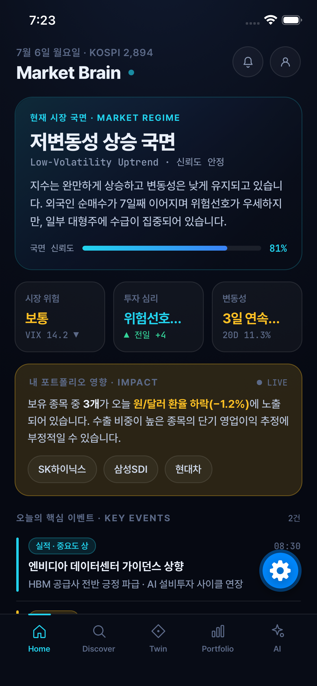
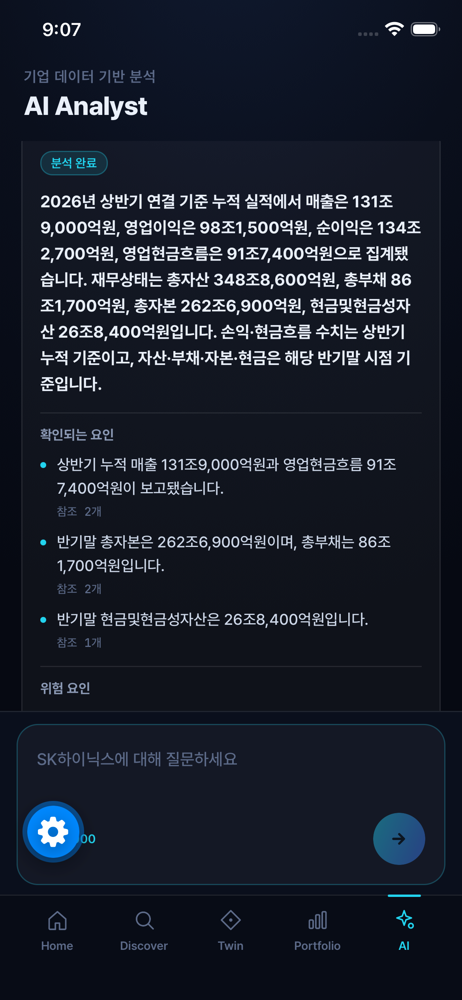
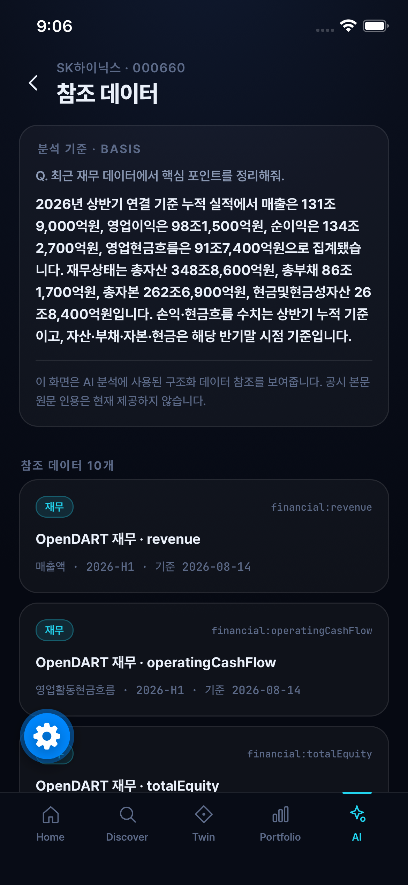

# ALPHA TWIN

**기업·재무 데이터와 AI 분석을 함께 살펴보는 투자 인텔리전스 모바일 앱**

여러 곳에 흩어진 한국 상장기업의 시세·공시·재무 정보를 한곳에서 살펴보고, AI 분석에 사용된 참조 데이터를 함께 확인할 수 있도록 만드는 모바일 앱입니다.

> **개발 진행 중** · 실제 데이터와 Mock 기반 화면이 함께 존재합니다. 실시간 거래·주문 서비스가 아니며, 앱 출시 및 운영 완료 상태를 의미하지 않습니다.

| 프로젝트 | 내용 |
| --- | --- |
| 작성자 | 김지원 |
| 개발 기간 | 2026.06 ~ 현재 |
| 형태 | 개인 프로젝트 |
| 담당 | 서비스 기획·요구사항 구체화, 단계별 개발 범위 관리, 실행 결과 확인 및 개선 |

[주요 기능](#주요-기능) · [기술 스택](#기술-스택) · [아키텍처](#아키텍처) · [로컬 실행](#로컬-실행) · [검증](#검증)

## 실행 화면

| Home · Mock 화면 | AI Analyst · 재현 실행 | 동일 세션의 참조 데이터 |
| :---: | :---: | :---: |
|  |  |  |

실제 iOS Simulator 캡처입니다. Home의 시장·포트폴리오 내용은 Mock이며, LIVE 표기도 실시간 연동을 의미하지 않습니다. AI 두 화면은 **2026-09-24 21:01 KST 분석 실행**에서 재무 스냅샷을 고정한 통제 사례입니다. 현재 시세나 최신 실행 결과가 아니며, 답변 전체의 정확성을 보장하지 않습니다. [촬영 맥락과 한계](docs/images/README.md)

## 주요 기능

| 영역 | 구현 내용 | 현재 범위 |
| --- | --- | --- |
| **Company Twin** | 확정 시세·일봉, 기업개황, 공시, 정규화 재무 8개 항목 | 금융위원회·OpenDART 백엔드 연동 |
| **AI Analyst** | 기업 질문·답변, 분석에 사용한 참조 데이터 확인 | OpenAI 기반 백엔드·모바일 연동, 서버 키 설정 필요 |
| **모바일 탐색** | 온보딩, 관심 종목, Home·Discover·Twin·Portfolio·AI 탭 | 화면 이동·로컬 상태 저장 구현 |
| **분석 화면** | Scenario Lab, Portfolio X-Ray, 투자 논제, 관계 지도 | Mock·시연용 또는 준비 중 상태 포함, 실제 예측 엔진 아님 |
| **모션·접근성** | 차트 draw-in, 접기·펼치기, 그래프 확대·이동, RichText | 애니메이션 설정·시스템 Reduce Motion 반영 |
| **공시 검색 기반** | 원문 파싱·청킹, lexical/dense 검색, 근거 사용 조건 검증 | 별도 백엔드 개발 기반. 기본 AI 답변 통합·검색 품질 평가는 진행 과제 |

## 기술 스택

버전은 저장소의 패키지 선언 또는 검증 환경 기준입니다.

| 계층 | 기술 | 용도 |
| --- | --- | --- |
| **모바일** | React Native 0.86 · React 19.2 · Expo SDK 57 · TypeScript | iOS/Android 앱 |
| **라우팅·상태** | Expo Router · AsyncStorage | 화면 이동, 온보딩·설정 등 로컬 상태 |
| **UI·인터랙션** | Reanimated 4 · Gesture Handler · React Native SVG · Safe Area Context | 차트, 그래프, 모션, 화면 영역 대응 |
| **폰트** | Pretendard · JetBrains Mono · Expo Font | 본문·수치 표시 |
| **백엔드** | Node.js · TypeScript · Fastify 5 | API, 입력 검증, Provider 조합 |
| **금융 데이터** | 금융위원회 공공데이터 · OpenDART | 확정 시세·일봉, 기업·공시·재무 |
| **AI** | OpenAI SDK · Responses API · js-tiktoken | 질문 처리, 구조화된 답변, 토큰 계산 |
| **공시 처리** | fast-xml-parser · yauzl | XML 처리, ZIP 검증·해제 |
| **저장·검색** | PostgreSQL 16 · pgvector · node-postgres | 공시·청크·작업 상태 저장, lexical/vector 검색 기반 |
| **마이그레이션** | node-pg-migrate | 스키마 이력·순서 관리 |
| **검증** | Node.js Test Runner · tsx · TypeScript compiler | 단위 테스트·타입 검사·격리 DB 통합 검증 |

## 아키텍처

```text
Expo / React Native
        |
        | ALPHA TWIN API (DTO)
        v
Fastify Backend
  +-- Market Data Service ---- 금융위원회 / Mock Provider
  +-- OpenDART Service ------- 기업 · 공시 · 재무 정규화
  +-- AI Analyst ------------ 분석 입력 구성 -> OpenAI -> 참조 검증

별도 개발 중인 공시 검색 기반
  원문 -> 검증·파싱 -> 청크 -> PostgreSQL
                             +-- lexical index
                             +-- embedding / vector retrieval
                             +-- eligibility · activation · evidence guard
```

### 기술적 설계 포인트

- **Provider와 DTO 분리:** 외부 응답을 내부 계약으로 변환해 모바일의 외부 API 의존성을 줄입니다.
- **실패 상태 구분:** 캐시·stale·Mock fallback을 구분하며 모든 데이터 경로에 같은 fallback을 적용하지 않습니다.
- **재무 의미 보존:** 금액을 정수 문자열로 유지하고 연결/별도·분기/누적·기간·출처를 구분합니다.
- **AI 참조 검증:** 서버가 제공한 참조 ID 범위를 검사합니다. 답변 전체의 사실성을 보장하는 검증은 아닙니다.
- **근거 사용 조건:** 문서·generation·activation 결속과 현재 상태를 확인하고, 근거가 부족하면 허용하지 않는 방향으로 개발합니다.
- **트랜잭션 검증:** 합성 자료와 격리 PostgreSQL로 상태 변경·rollback·동일 client의 미커밋 값 가시성을 검증합니다.

## 저장소 구조

```text
apps/
  mobile/
    app/                    Expo Router 화면
    components/             모바일 UI 컴포넌트
    lib/                    앱 상태·폰트 등 공통 기능
    src/                    디자인 토큰·서비스·Mock 데이터
  api/
    src/
      ai/                   AI Gateway·분석 입력·응답 검증
      providers/            시장 데이터 Provider
      openDart/             기업·공시·재무 데이터 처리
      filingIntelligence/   공시 저장·작업 처리·검색·근거 검증
      infrastructure/       DB 연결·트랜잭션
    migrations/             PostgreSQL 스키마
    test/                   단위 테스트·합성 fixture
    integration-test/       PostgreSQL 통합 테스트
    evaluation/             검색 평가 코드
docs/                       데이터 계약·설계 문서
design/ · specs/ · assets/   초기 디자인 원본·명세·브랜드 자료
src/                        초기 인계 자료의 타입·토큰·Mock 소스
```

실행 앱은 `apps/mobile`, 서버는 `apps/api`에 있습니다. 루트 디자인·인계 자료는 초기 설계 기록이며 현재 구현 및 상태와 구분합니다.

## 로컬 실행

### 준비

- Node.js와 npm: 백엔드의 `--env-file-if-exists` 옵션을 지원하는 Node.js가 필요합니다.
- 문서 정리 시 로컬에서 확인한 버전은 **Node.js v22.21.0**입니다. 모든 Node 버전·OS 조합의 호환성을 보장하는 표기는 아닙니다.
- iOS 시뮬레이터는 macOS·Xcode, Android 에뮬레이터는 Android 개발 환경이 필요합니다.
- 기본 Mock 시세 API 실행에는 PostgreSQL이나 외부 API 키가 필요하지 않습니다.

### 1. 백엔드

저장소 루트에서 실행합니다.

```bash
cd apps/api
npm ci
npm run start
```

기본 주소는 `http://127.0.0.1:4000`입니다. 자동 재시작은 `npm run dev`를 사용합니다.

### 2. 모바일

별도 터미널에서 저장소 루트를 기준으로 실행합니다.

```bash
cd apps/mobile
npm ci
EXPO_PUBLIC_ALPHA_TWIN_API_BASE_URL=http://127.0.0.1:4000 npx expo start
```

Expo 터미널에서 `i`로 iOS 시뮬레이터, `a`로 Android 에뮬레이터를 엽니다. 위 주소는 같은 Mac의 iOS 시뮬레이터 기준입니다. Android 에뮬레이터는 보통 `10.0.2.2`, 실기기는 개발 PC의 LAN 주소를 사용하며 서버 listen 주소·방화벽도 별도로 설정해야 합니다.

### 실데이터·AI 설정

| 기능 | 서버 설정 | 설정하지 않은 경우 |
| --- | --- | --- |
| 공공데이터 | `MARKET_DATA_PROVIDER=public-data`, 관련 서버 환경변수 | 기본 시장 데이터는 Mock Provider 사용 |
| 기업·공시·재무 | `OPENDART_API_KEY` | 해당 API는 설정 필요 오류 반환 |
| AI Analyst | `OPENAI_API_KEY`, 지원 모델 설정 | AI API는 설정 필요 오류 반환 |
| 공시 저장·검색 | 별도 DB·worker 설정 | 기본 화면 실행과 분리된 선택적 구성 |

환경변수 목록은 `apps/api/.env.example`을 참고하세요. 실제 키는 ignored 상태의 서버 `.env`에서만 관리하고, `EXPO_PUBLIC_*`에는 API 주소처럼 공개 가능한 값만 넣습니다. 외부 API 호출에는 사용 제한과 비용이 적용될 수 있습니다.

## 검증

**백엔드** (`apps/api`):

```bash
npm run typecheck
npm run lint
npm run test
npm run build
```

**모바일** (`apps/mobile`):

```bash
npx tsc --noEmit
npx expo-doctor
npx expo export --platform web
```

- 백엔드 `lint`는 현재 `tsc --noEmit` 기반입니다.
- 단위 테스트는 합성 fixture·Fake Provider를 활용하며 실제 API 및 PostgreSQL 검증과 구분합니다.
- DB 테스트는 전용 격리 환경에서만 실행하세요. 운영 DB나 보존 중인 benchmark DB를 사용하면 안 됩니다.
- 위 명령은 실행 안내이며, 특정 시점의 전체 테스트 통과를 보장하는 배지가 아닙니다.

## 현재 한계와 다음 과제

- 금융위원회 데이터는 **최근 확정 시세**이며 실시간 가격이 아닙니다. 수정주가 여부가 확정되지 않은 데이터로 장기 수익률을 단정하지 않습니다.
- 시나리오·점수·추천 화면에는 Mock 또는 준비 중 기능이 남아 있습니다. 로그인 화면은 운영 인증 서버 구축 완료를 뜻하지 않습니다.
- 공시 검색 구현·합성 검증과 실제 공시 계보 승인·검색 품질 평가·AI 답변 통합은 별도 단계입니다.
- 실계좌, 주문·자동매매, 운영 인증, 앱스토어 배포는 완료 범위에 포함하지 않습니다.
- AI 답변은 투자 수익이나 정보의 완전한 정확성을 보장하지 않습니다.

## 개발 방식

서비스 기획과 작업 범위를 정하고, ChatGPT·Codex를 활용해 구현·수정 및 결과 검토를 진행합니다.

| 역할 | 담당·활용 범위 |
| --- | --- |
| **작성자** | 서비스 기획, 요구사항 구체화, 단계별 범위 결정, 구현·수정 요청, 결과 확인과 진행 관리 |
| **ChatGPT** | 요구사항·설계 논의, 작업 프롬프트 작성, 공유된 작업 보고서·테스트 결과·화면 검토 |
| **Codex** | 로컬 코드 구현·수정, 테스트 작성·보강, 승인된 검사 실행 및 변경 결과 정리 |

테스트 작성과 실제 실행은 구분하며, 개별 검증 결과는 실행 기록을 기준으로 확인합니다.

### 검토 절차

작업 범위를 단계별로 나누고, 구현 결과를 화면 확인·테스트·최종 감사로 검토합니다. 코드 확인, 합성 자료 테스트, 실제 외부 서비스 연동 검증은 구분해 기록합니다. 변경은 작업 브랜치에서 진행하며, 검토와 승인 후 main에 반영합니다.

## 관련 문서

- [데이터 계약](docs/data-contracts.md)
- [Admission Evidence Provider](docs/admission-evidence-provider.md)
- [백엔드 상세 문서](apps/api/README.md)
- [모바일 상세 문서](apps/mobile/README.md)
- [초기 개발 계획 보관본](docs/archive/initial-development-plan.md) · 현재 작업 목록이 아닌 초기 설계 기록

실행 설정과 기능별 제약은 하위 문서를 참고하세요. DB·worker 구성은 기본 앱 실행과 별도로 준비해야 합니다.
